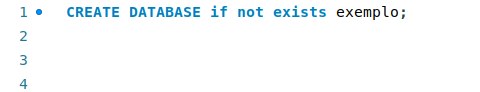

# Comandos Básicos DDL

## Comandos DDL

Os comandos DDL (Data Definition Language ou Linguagem de Definição de Dados) são comandos que alteram a estrutura dos objetos de um banco de dados. Os comandos DDL são comandos usados para definir, alterar e apagar as estruturas dos objetos de um banco de dados, tabelas, índices, visões e esquemas, são alterados por estes comandos. Os comandos básicos de DDL são `DROP`, `ALTER`, `CREATE`.

## Comandos base

Os comandos são comandos pilares para entendermos oque é um comando DDL de fato, comandos que não demandam complexidade no sentido técnico. Os comandos base são `CREATE`, `ALTER` e `DROP`esses comandos são comandos universais, diferente de outros comandos DDL eles estão na maioria dos sistemas de gerenciamento de banco de dados. Todos esses comandos possuem funcionalidades que afetam a estrutura dos objetos de um banco:

- `CREATE`: O comando CREATE cria bancos e tabelas. O comando CREATE cria tabelas e bancos atráves do comando `CREATE TABLE nometabela` ou `CREATE DATABASE nomebanco`, esses comandos possuem algumas mudanças e alterações que mudam alguns conceitos das estruturas criadas:
    
    

    Como vemos no exemplo o comando CREATE DATABASE que serve para a criação de bancos como, vimos anteriormente, porém a uma diferança no comando, em conjunto ao comando que já conhecemos vemos o `if not exists`, essa parte do comando garante que a criação não seja efetuada caso outro banco com o mesmo nome já exista, isso evita erros. Essa segunda parte do comando tambem vale para outros comandos DDL;

- `ALTER`: O comando ALTER permite que alteremos a estrutura de algo dentro do banco de dados. O comando permite adentrar os campos de uma estrutura, como por exemplo uma tabela, e alterar ou excluir esse campo, através do comando `ALTER TABLE nometabela`, esse comando possue 6 formatos diferentes que permitem diferentes comportamentos, porém são comandos um pouco mais complexos, o ALTER comum possui as principais formas de ação ADD, DROP, MODIFY e CHANGE:

    

    Todas as formas de ação possuem mais ou menos a mesma estrutura do exemplo, ALTER em conjunto com o comando e o nome da estrutura (ALTER TABLE cursos), e logo em seguida a ação o nome do campo, coluna e as configurações da coluna (ADD COLUMN nome varchar(30)). Essas ações possuem reações diferentes, resumidamente as ações ADD, DROP, MODIFY e CHANGE fazem:

    - `ADD`: A ação add permite adicionar uma nova coluna, indice ou restrição;

    - `DROP`: A ação drop permite apagar uma coluna, indice ou restrição;

    - `MODIFY`: A ação modify altera o tipo de dado ou as propriedades de uma coluna;

    - `CHANGE`: A ação change altera o nome de uma coluna ou opicionalmente o tipo de dado dessa coluna.

- `DROP`:  O comando DROP pode ser usado sem o auxilio do ALTER. O comando DROP permite apagar permanentemente objetos do banco de dados, diferente do drop usado com o auxilio do ALTER, ao invés de apagar campos, o DROP pode apagar tabelas, bancos de dados ou indices inteiros, através dos comandos `DROP DATABASE nomebanco` apaga banco e `DROP TABLE nometabela` apaga tabela.

    

    A estrutura do DROP é bem simples, apenas com o comando e o nome da estrutura o comando é efetuado.