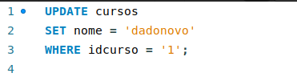
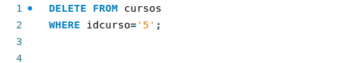
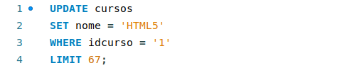
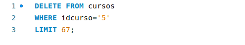

# Manipulação e Limpeza de Dados

## O que são Dados?

Os dados dentro de um banco de dados são informações armazenadas em tabelas, compostas por colunas e listas. Os dados são informações armazenadas em tabelas separadas por colunas, esses dados podem ser alterados, excluidos ou editados através dos comandos DML (Data Manipulation Language), esses comandos são classificados como comandos de manipulação de dados. Entre os comandos DML, os principais comandos são `INSERT`, `UPDATE` e `DELETE`.

## Edição de dados 

O comando DML responsável por editar/modificar os dados é o UPDATE. O comando UPDATE permite a edição/modificação de dados através da coluna e o dado novo e para referêciar o ponto ou os pontos editados usamos uma coluna em conjunto com um dado para a edição, na prática o comando pode editar uma coisa ou várias coisas com base na referência. Para compreendermos melhor um exemplo a seguir:

No exemplo vemos que o `UPDATE` indica a tabela editada, o `SET` indica a coluna e o valor que ocupara a coluna e o `WHERE` indica atráves da coluna a linha que deve ser editada, na prática esse comando edita todo valor da coluna `nome` que estiver com o valor `1` na coluna `idcurso`.

## Exclusão de dados 

O comando DML responsável pela exclusão de dados é o comando DELETE. O comando DELETE permite a exclusão de dados por completo, o comando permite que um conjunto de linhas ou uma linha seja apagada através de uma condição, esse comando se utiliza do nome da tabela e a condição para ser apagada. para entender melhor um exemplo a seguir:

No exemplo o `DELETE FROM` indica a tabela onde os dados serão excluidos e o `WHERE` indica a condição que o dado tem que ter para ser excluido, em resumo o comando efetua a exclusão da linha se o dado que está na coluna `idcurso` seja `8`.

## Limitação

Os dois comandos apresentados UPDATE e DELETE possuem uma limitação. O comando LIMIT permite com que possamos impedir grandes erros, os comandos apresentados não possuem em sua origem uma forma de reversão, por tanto, é importante se assegurar que a exclusão ou edição dos dados seja correta, o comando LIMIT ajuda a assegurar a integridade dos dados colocando um limite de edições ou exclusões:

Os dois exemplos impedem que ajam mais de 67 exclusões ou alterações de linhas, isso serve para assegurar a integridade dos dados, como citado alteriormente.