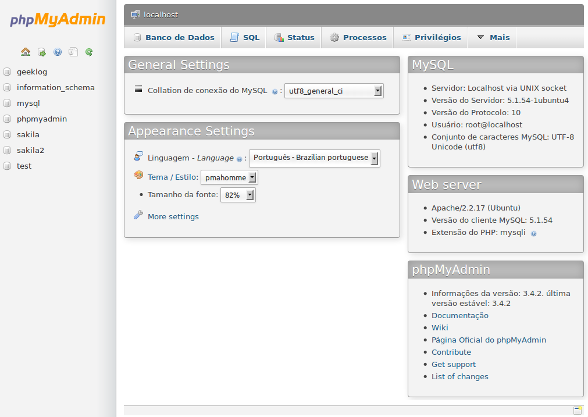

# phpMyAdmin

## O que é phpMyAdmin

O phpMyAdmin é uma ferramenta de software livre e código aberto feito em PHP, a ferramenta permite a administração de bancos de dados MySQL e MariaDB através da Web. O phpMyAdmin é uma ferramenta simples e intuitiva que permite controler um banco de dados através de uma interface Web conectada na rede, a interface permite o controle através de objetos gráficos oque torna mais fácil e rápido na interação entre administrdor e banco, esse tipo de ferramenta principalmente o phpMyAdmin é muito utilizada para administrar bancos na nuvem, principalmente em hospedagens. hoje é padrão a utilização do phpMyAdmin em hospedagem quando falamos de banco de dados MySQL e MariaDB.

 

